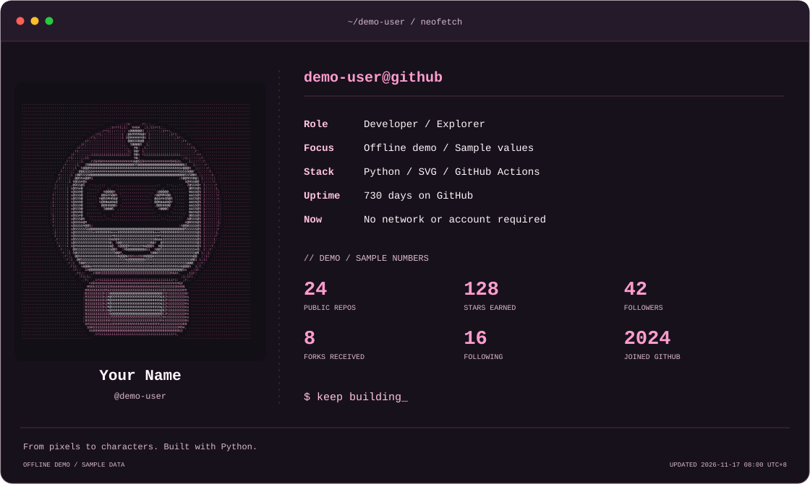
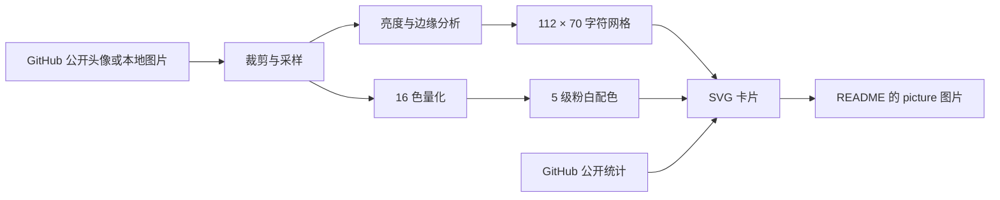

# 从 GitHub 头像到粉白 ASCII 个人主页

这份教程带你做一张终端风格的 GitHub 个人资料卡：左边是由字符组成的头像，右边是个人介绍与真实的公开 GitHub 数据。它使用 Python 和 Pillow 生成 SVG，再通过 GitHub Actions 自动更新。

你不需要部署网站，也不需要购买图片 API 服务。最终图片和生成脚本都保存在自己的仓库中。



上图为程序绘制的机器人与示例统计，用来展示布局，不代表任何人的真实 GitHub 数据。

## 1. 先分清两个仓库

- **`ascii-profile-lab`** 是教程与可复用模板。
- **`你的用户名/你的用户名`** 才是 GitHub 个人主页仓库。

例如，你的 GitHub 用户名是 `octocat`，个人主页仓库就应当叫 `octocat/octocat`。GitHub 会把这个公开仓库根目录的 `README.md` 显示在个人主页上。

仓库必须公开，根目录必须有非空的 `README.md`，仓库名必须与用户名一致。详见 [GitHub 的个人主页 README 说明](https://docs.github.com/en/account-and-profile/how-tos/profile-customization/managing-your-profile-readme)。

不要直接把教程仓库 Fork 成 `ascii-profile-lab`，然后期待它出现在个人主页。推荐使用模板创建自己的同名仓库。

## 2. 不安装软件，先在 GitHub 上完成一遍

### 第一步：创建自己的同名公开仓库

1. 打开本仓库首页，点击 **Use this template → Create a new repository**。
2. Owner 选择自己的账号。
3. Repository name 填自己的 GitHub 用户名。
4. 选择 **Public**，创建仓库。

如果同名仓库已经存在，先把原来的 README 和资源保存好，再将模板中的脚本、配置、工作流和资源复制进去。不要为了套模板删除现有仓库。

如果界面没有 **Use this template**，也可以下载本仓库 ZIP，解压后把文件上传到自己的同名公开仓库。相关说明见 [从模板创建仓库](https://docs.github.com/en/repositories/creating-and-managing-repositories/creating-a-repository-from-a-template)。

### 第二步：编辑 `profile.json`

打开根目录的 `profile.json`，将用户名和展示名改成自己的：

```json
{
  "username": "your-github-username",
  "name": "Your Name"
}
```

`username` 是 GitHub 账号名，不是个人资料页上可以自由修改的昵称。模板中的其他简介字段可以按需填写，例如角色、研究或创作方向、常用技术、最近在做的事。

初次使用时，直接修改仓库里提供的完整配置最方便；想从最小配置开始，也可以只保留上面两个字段。没有填写的可选信息由模板采用默认值。

`profile.json` 中的 `YOUR_USERNAME` 只是占位符，必须替换后才能运行个人主页更新。个人介绍应当编辑在配置文件中；主页工作流会重新生成卡片与个人主页 README。

### 第三步：运行 GitHub Actions

1. 打开自己仓库的 **Actions** 页面。
2. 选择 **ASCII Profile Lab** 工作流。
3. 点击 **Run workflow**，选择 `main` 分支并运行。
4. 等待工作流显示绿色成功状态。
5. 打开 `https://github.com/你的用户名`，查看个人主页。

个人主页工作流会安装依赖、获取公开资料、转换头像、生成四张卡片和 README，然后自动提交更新。它使用 GitHub 自动提供的 `GITHUB_TOKEN`，无需粘贴个人 Token。

工作流只在 `账号名/账号名` 仓库中更新个人主页，并校验配置中的 `username` 与仓库所有者一致。教程仓库自身只执行代码检查、测试与匿名演示生成，不抓取维护者的真实统计，也不把教程首页替换成个人主页。

初次从模板创建仓库时，示例可能暂时仍是匿名演示。完成配置并成功运行工作流后，它才会换成你的头像和数据。

## 3. 在本地生成：方便调色与反复预览

安装 Python 3.12，然后在项目根目录运行：

```sh
python -m pip install -r requirements.txt
python scripts/fetch_stats.py
python scripts/generate_profile.py
```

第一条安装 Pillow；第二条把公开统计写入 `assets/stats.json`；第三条转换当前 GitHub 头像，生成字符缓存、四张 SVG 和 **`PROFILE_README.md`**。

默认命令不会覆盖教程的 `README.md`。确认成品后，在自己的同名主页仓库中可以显式生成主页 README：

```sh
python scripts/generate_profile.py --readme README.md
```

个人主页工作流会自动传入这个参数，因此不需要每次手动复制文件。

如果电脑上用 `python3` 启动 Python，将命令中的 `python` 换成 `python3` 即可。推荐使用虚拟环境，避免与其他项目的依赖混在一起。

已经成功生成过一次后，可以离线调整布局：

```sh
python scripts/generate_profile.py --offline
```

`--offline` 使用现有统计与字符缓存，不访问头像地址。它不会凭空产生另一个账号的数据：修改 `username` 后，先重新运行 `fetch_stats.py`，再生成卡片。

### 使用本地照片

如果希望使用与 GitHub 头像不同的图片，可以指定本地文件：

```sh
python scripts/fetch_stats.py
python scripts/generate_profile.py --portrait "path/to/your-photo.png"
```

这条命令在本地读取图片、按 EXIF 信息修正方向，再生成字符画；图片不会因此上传到外部转换网站。后续调样式可使用 `--offline` 保留已经生成的字符缓存。

默认的在线生成与个人主页工作流使用当前 GitHub 头像。如果希望自动更新时也固定使用自选图片，可以把图片放在自己的仓库中，并在 `profile.json` 中加入 `"portrait_path": "images/portrait.png"`。也可以在工作流生成命令里传入 `--portrait`；只在本地运行一次该参数，不会改变后续工作流的输入来源。

原始照片不必随生成结果一起提交。SVG 和字符缓存本身仍会呈现头像内容，发布前可以直接打开成品检查。

### 完全离线试用匿名演示

不想先连接自己的 GitHub 数据，可以运行：

```sh
python scripts/generate_profile.py --demo
```

该模式不访问网络，使用程序绘制的机器人头像和明确标记的示例统计，默认写入 `examples/`。它与个人卡片的生成资源分开，方便比较效果。

输出位置也可以自行指定：

```sh
python scripts/generate_profile.py --demo --output-dir preview --readme preview/PROFILE_README.md
```

## 4. 生成流程是什么样的？



头像不是作为一张原图嵌进卡片中。脚本真正把图像变成了字符与颜色，再使用 SVG 的 `<text>` 和 `<tspan>` 绘制这些字符。

## 5. 为什么使用 112 × 70 个字符？

等宽字体的字符格通常比正方形更窄。如果把正方形图片直接转换成正方形字符网格，再按正常行距显示，头像容易被拉长。

这版布局中，头像宽约 328 个 SVG 单位，包含 112 列；行距约 4.69，包含 70 行：

```text
横向：328 / 112 ≈ 2.93
纵向：70 × 4.69 ≈ 328
```

因此，虽然字符网格是 `112 × 70`，显示出来的头像区域接近正方形，能保留原来的脸型和比例。

相比 `60 × 36`，`112 × 70` 提供了约 3.6 倍的采样格，眼睛、发丝和手势可以保留更多细节。但字符数并非越多越好：如果把成品缩得很小，更密的字符仍会挤在一起。调整分辨率时，也要同时检查最终显示尺寸与行距。

## 6. 让头像清楚的关键：亮度、锐化和边缘

### 裁剪、缩放与灰度

脚本先把图片转为 RGB，居中裁成正方形，再使用 Lanczos 缩放为目标网格。接着生成灰度图，并用：

```python
ImageOps.autocontrast(grayscale, cutoff=1)
```

拉开明暗范围，减少图片整体偏灰时的层次损失。

### 在采样后轻度锐化

```python
ImageFilter.UnsharpMask(radius=0.8, percent=150, threshold=2)
```

锐化能强化眼睛、刘海和脸部边界。它不是恢复原图没有的细节；参数过高也会制造噪点，所以这里采用较轻的设置。

### 混合亮度与边缘

灰度图经过 `FIND_EDGES` 得到边缘强度。设归一化灰度为 `L`、边缘为 `E`，字符密度使用：

```python
density = min(1, 0.87 * L ** 0.88 + 0.13 * E)
```

- `L ** 0.88` 稍微提亮中间调。
- 87% 的亮度保持原图整体结构。
- 13% 的边缘帮助保留五官、发丝和轮廓。

脚本忽略图像最外圈的边缘值，减少边缘滤镜在画框边界产生的假线条。

再把密度映射到从稀疏到密集的字符序列：

```python
ramp = " .,:;irsXA253hMHGS#9B&@"
character = ramp[round(density * (len(ramp) - 1))]
```

这套映射针对深色头像底面：亮的头发和皮肤使用更密的字符，暗部使用较稀疏的字符。

我们最初试过把亮部映射成空格。放在深色背景上时，白发和脸部会变成大片空白，而深色衣服却显得很实，头像就不容易辨认。修正明暗方向比单纯增加字符数更有效。

## 7. 粉色与白色是怎样生成的？

先把原图量化为 16 种代表色，再根据颜色亮度映射到五级粉白色：

```text
#b74b85 → #e77ab4 → #ffaad4 → #ffd4eb → #fff5fc
```

颜色亮度按下面的权重计算：

```python
luminance = (0.2126 * R + 0.7152 * G + 0.0722 * B) / 255
color_index = min(4, int(luminance * 5))
```

亮部接近白色，中间调为粉色，较暗部分为深粉色。字符密度负责结构，颜色负责层次；两者一起作用，让白发、脸部和眼睛更容易区分。

头像底面固定为深色，文字和高光才有足够的对比度。即便 GitHub 使用浅色主题，这个粉白方案也保留深色卡片背景，而不是把白色字符放在白色页面上。

## 8. 为什么用 SVG？怎样避免文字错位？

SVG 在 README 中按图片显示，适合保存终端式排版。它可以缩放，也可以给每段字符单独上色，而不需要在 README 中执行 JavaScript。

每一行由一个 `<text>` 绘制，相邻同色字符合并成 `<tspan>`。例如：

```xml
<text x="30" y="145" font-size="4.7" xml:space="preserve" textLength="328" lengthAdjust="spacingAndGlyphs"><tspan class="p4">###</tspan><tspan class="p2">:::...</tspan></text>
```

这里的几个细节很重要：

- **等宽字体**让字符格保持规律。
- **`xml:space="preserve"`** 保留空格，它们也是头像的一部分。
- **`textLength="328"`** 固定每行显示宽度，减少不同系统字体回退引起的漂移。
- **相邻同色段合并**减少 SVG 节点和文件体积。
- **XML 转义**保护 `&`、`<`、`>` 等字符，避免它们被误当成标签。

修改粉白配色时，调整脚本中的颜色表；修改信息文字颜色时，调整 `THEMES`。GitHub 会过滤普通 README 中的大量自定义样式，因此这里把精确颜色和排版放在 SVG 内部。

## 9. 桌面与手机为什么分别生成？

桌面卡片横向排列头像和信息；手机卡片把头像与信息上下排列。若只把横版卡片缩小到手机宽度，右侧文字会很难读。

脚本分别生成桌面、手机以及两种主题对应的四张 SVG，再由 README 的 `<picture>` 选择：

```html
<picture>
  <source media="(max-width: 640px) and (prefers-color-scheme: dark)" srcset="手机深色图">
  <source media="(max-width: 640px)" srcset="手机浅色图">
  <source media="(prefers-color-scheme: dark)" srcset="桌面深色图">
  
</picture>
```

`<source>` 的顺序会影响选择结果。最具体的“手机且深色”放在前面，最后用 `` 提供回退图片。

## 10. 统计数据的口径

`fetch_stats.py` 请求 GitHub 公开用户接口与分页仓库列表，只输出需要的公开字段。

| 字段 | 含义 |
| :--- | :--- |
| Public repos | 本人拥有的公开仓库数量，包含公开 Fork 仓库 |
| Stars earned | 这些公开仓库收到的 Stars 合计 |
| Forks received | 这些公开仓库收到的 Forks 合计 |
| Followers / Following | 公开关注数据 |
| Uptime | GitHub 账号注册至今的天数，不是个人年龄 |
| Languages | 非 Fork 公开仓库的主要语言计数，不代表熟练程度或代码行占比 |

本项目不使用“仓库数乘一个常数”来推算 Commits 或代码行数，也不将私有仓库名、邮箱等字段写入公开统计文件。手动填写的 `stack` 是自我介绍，与自动统计的仓库主要语言是两回事。

仓库内置的匿名演示数据仅用于展示布局。完成自己的配置后，应先运行统计抓取，再发布个人卡片。

## 11. 自动刷新与图片缓存

个人主页工作流每天计划在北京时间 08:17 运行，也支持手动触发；修改配置、脚本、依赖或工作流会触发重新生成。生成文件的提交不会再次触发同一套更新，避免循环。教程仓库本身不会按这个计划生成某人的个人主页。

GitHub 的计划任务可能延迟。公开仓库长时间没有活动时，计划任务可能被停用，可回到 Actions 页面检查并重新启用。见 [GitHub 的 schedule 事件说明](https://docs.github.com/en/actions/reference/workflows-and-actions/events-that-trigger-workflows#schedule)。

### 已经提交新图，主页为什么还显示旧图？

浏览器和图片服务可能仍在使用缓存。这次实现中，经过 GitHub `/raw/main/` 跳转的相对图片地址曾继续展示旧图。

生成器改为使用直接的原始文件地址，并根据每张 SVG 的内容计算 SHA-256 摘要，把摘要加入图片地址：

```text
https://raw.githubusercontent.com/用户名/用户名/main/assets/profile-light.svg?v=内容摘要
```

图片内容变化，地址的版本参数也会变化。这里使用内容摘要，而不是每次任意添加时间戳，让相同图片仍能复用缓存。

如果刚更新后仍看到旧版，先确认工作流成功、README 图片地址的版本参数已变化，再刷新页面。不要反复覆盖同一张旧图来排查。

## 12. 常见问题

### 工作流成功，但个人主页没有 README

检查目标仓库是不是 `用户名/用户名`、是否公开、根目录是否有非空的 `README.md`。教程仓库自身的名字不满足个人主页的同名条件。

### 工作流提示没有写入权限

确认工作流保留了 `permissions: contents: write`。如果账号或组织对 Actions 有统一限制，还需要遵守对应仓库策略。不要把个人 Token 写进代码或 README。

### 图片或文字被截断

先缩短 `role`、`focus`、`stack`、`now` 等卡片短字段。完整履历更适合写在卡片下方的正文中。调整 SVG 坐标后，同时查看桌面版和手机版。

### 头像仍然不够清楚

优先选择主体较大、五官清楚、背景简单的图片。先核对亮度方向和背景对比度，再尝试调整采样网格、锐化强度与边缘权重。每次只改变一组参数，便于判断改动带来的效果。

### 想换头像但保留粉白样式

修改 GitHub 头像后，正常运行一次生成器或 Actions。想保留当前字符结果，只修改布局和文案时，则使用 `--offline`。

### 修改 README 后，下次更新被覆盖

个人主页工作流显式使用 `--readme README.md`，因此会重写同名主页仓库中的 README。长期修改应放在 `profile.json` 或 README 生成逻辑中，再重新生成。平时在教程仓库本地运行生成器，默认写入 `PROFILE_README.md`，不会覆盖教程首页。

---

建议先完成一次“模板 → 同名仓库 → 修改配置 → 手动运行”，确认成品出现，再逐项修改字符密度、颜色与版式。这样每一步都有可比较的结果。
